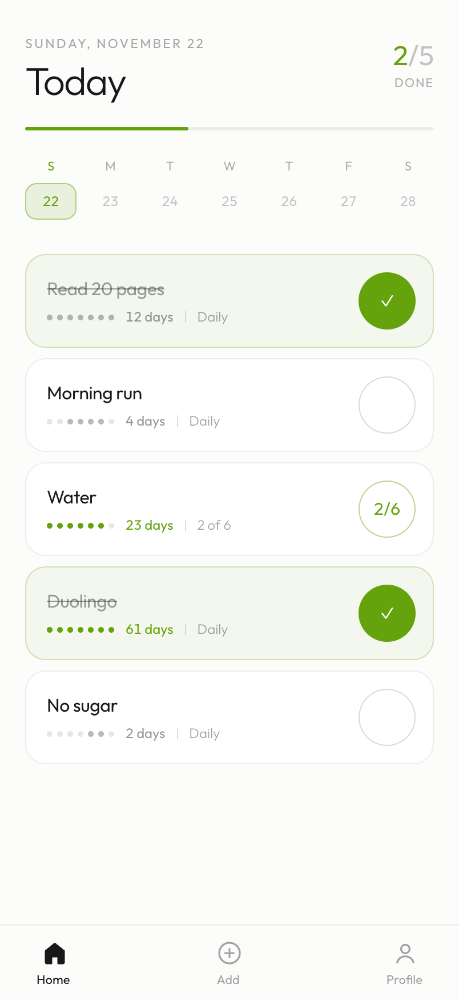
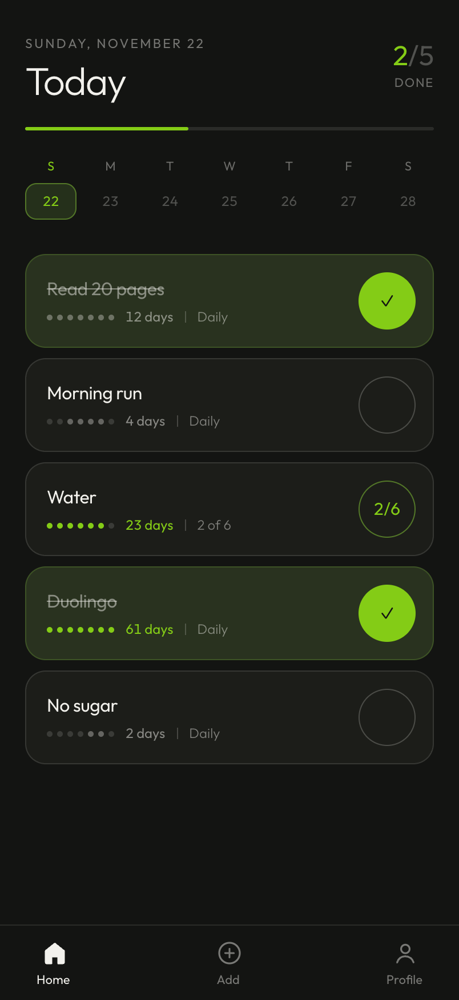

# Streaks

A minimal habit tracker for the phone: today's habits, one tap to complete, and a
streak that holds. Installable as a PWA, local-first, no account needed.

**Live demo:** https://streaks-tau-brown.vercel.app (built for a phone-sized screen)

The interesting parts are small but easy to get wrong: a streak that holds through
today, a day that rolls over while the app is open, and a first screen that the server
and the browser render identically.

<p>
  
  
</p>

The screenshots use sample habits. The live demo starts empty: pick one of the
suggestions on the first screen to create your first habit.

## Features

- One tap marks a habit done. Tapping again undoes it.
- Count habits ("Water, 6 glasses") fill up one tap at a time.
- Create a habit with a name and a daily target.
- A streak holds through today until a whole day has passed without a hit.
- A seven-day trail and a week strip show recent days.
- Light, dark, or follow the system.
- Installable as a PWA.
- Data stays in the browser (`localStorage`). There is no account.

## Tech stack

Next.js 16 (App Router) · React 19 · TypeScript (strict) · CSS Modules · no UI
library, no state library · deployed on Vercel.

## Run it locally

```bash
npm install
npm run dev    # http://localhost:3000
```

In development the app seeds sample habits on the first run. A production build starts
empty.

```bash
npm run build  # production build
npm run lint   # type check (tsc --noEmit)
```

## Architecture

The code that matters is in [`lib/`](lib/):

| File | What it holds |
| --- | --- |
| `types.ts` | The stored shape and the view shape |
| `date.ts` | Local-day helpers |
| `derive.ts` | Streak, count and trail, computed from the log |
| `store.ts` | The state container and its persistence |
| `useHabits.ts` | The React hook that connects components to the store |
| `seed.ts`, `theme.ts` | Development seed data and theme handling |

A few decisions worth knowing:

- **Only the completion log is stored.** It maps a habit to the days it was done:
  `{ [habitId]: { [YYYY-MM-DD]: count } }`. Count, streak and trail are derived from it on
  every read, so they cannot drift out of sync.
- **Days are local calendar keys, not UTC.** A UTC key would put a late-night tap on the
  wrong day for anyone far from UTC.
- **State lives in a small external store, read with `useSyncExternalStore`.** Two
  screens share the data, the app has to render on the server too, and the day can
  change while the app is open. The reasoning and the alternatives I weighed are in
  [ADR 0001](docs/adr/0001-external-store.md).
- **Server and browser render the same first screen.** The store starts as an empty,
  not-ready snapshot. The saved data is read in an effect, and only then does Today
  show habits.
- **The day rolls over without a tap.** The app checks the day when it becomes visible
  again and sets a timer for midnight. Other tabs are kept in sync through the
  `storage` event.

## Status

In active development.

- **Not built yet:** editing and deleting habits, automated tests, and CI.
- **Known issue:** data the store cannot read (corrupt, or a different `version`) is
  replaced by an empty state when the page loads. Details in
  [ADR 0001](docs/adr/0001-external-store.md#consequences).

## Design

The original design handoff and HTML prototype live in [`docs/design/`](docs/design/).
